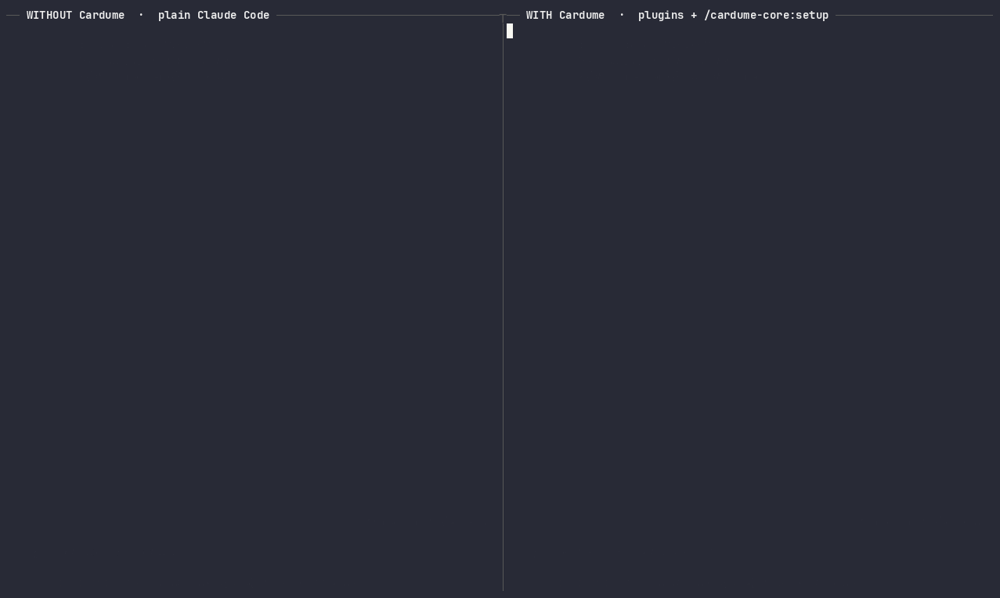
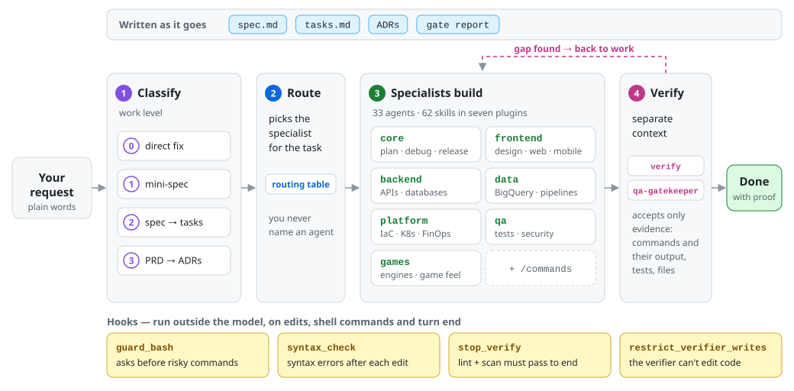
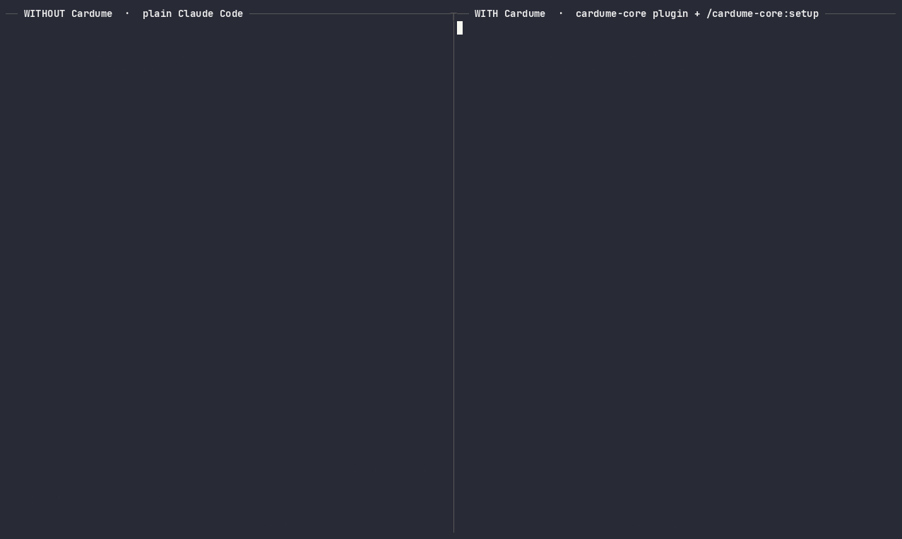

# Cardume

**Claude Code with a specialist for every part of the job.** Cardume adds product, architecture,
design, frontend, backend, data, platform, QA and security specialists that Claude calls on its own,
a process sized to each change, and hooks the model cannot skip.

English · [Português](README.pt-BR.md)

[](https://github.com/jeffersonvalente/cardume/actions/workflows/validate.yml)
[](LICENSE)
[](docs/CHANGELOG.md)

## Install

In Claude Code:

```text
/plugin marketplace add jeffersonvalente/cardume
/plugin install cardume-all@cardume
```

Then, once in each project:

```text
/cardume-core:setup
```

Setup shows a diff and asks before writing. It changes only a marked block in `CLAUDE.md` and adds
`.cardume/` to `.gitignore`. It also suggests the stack and code-navigation (LSP) plugins
that fit the project. After that, describe your task as usual: *"add multi-currency support to
invoices"*, *"the orders endpoint returns 500 sometimes"*. Cardume calls you only when the decision
is yours.

**For the whole team**, commit this as `.claude/settings.json` in the repository. Everyone who opens
the project and trusts the folder gets the marketplace and the plugins, with no server to run:

```json
{
  "extraKnownMarketplaces": {
    "cardume": {
      "source": { "source": "github", "repo": "jeffersonvalente/cardume" },
      "autoUpdate": true
    }
  },
  "enabledPlugins": { "cardume-all@cardume": true }
}
```

An organization can go further and require Cardume on every machine through managed settings, so it
can't be turned off. See [Use it with a team](docs/CONFIGURATION.md#use-it-with-a-team).

<p align="center"></p>

*Same request, two identical projects, recorded live (sped up). **Left:** plain Claude Code starts coding and
decides storage, money format and interface on its own. **Right:** Cardume classifies it as **Level 2**,
invokes `cardume-core:spec`, asks the decisions that change the design, writes a spec with numbered
requirements and waits for your approval before any code.*

## What you can hand it

Describe the task the way you would to a colleague. Claude picks the specialist; you never name an
agent. A sample of what gets routed where:

| You ask | Picked up by | You get |
| --- | --- | --- |
| "We're starting a booking platform for clinics" | `product-manager` → `software-architect` | PRD and architecture approved by you; ADRs and a feature list |
| "Give the pricing page a bolder look" | `design-flow` | Visual direction, critique and the polished page |
| "Build the website for the clinic" | `site-builder` + `design-flow` | Site structure, content, design and deploy steps |
| "Add invoice export with filters" | `spec` → `backend-specialist`, `frontend-specialist` | Spec, tasks, code and verification evidence |
| "Checkout returns 500 for some users" | `debugger` | Reproduction, root cause, fix and a regression test |
| "Why did yesterday's gold table lose rows?" | `data-engineer-gcp-bigquery` | Root cause from job and table history, with the queries it ran |
| "Review infra/main.tf before I apply it" | `iac-reviewer` | Findings by severity, what it couldn't verify, a verdict |
| "Pods in production keep restarting" | `kubernetes-copilot` | Read-only triage first; asks before any change |
| "Can we cut 20% of our cloud bill?" | `finops-architect` | Spend breakdown, ranked savings with the math, budget alerts |
| "Security review before launch" | `security-auditor` | OWASP, secrets and dependency findings, without edits |
| "Is phase 2 ready to approve?" | `qa-gatekeeper` | A gate report built from re-run checks, not from claims |
| "Prototype a 2D platformer in Godot" | `game-developer` | Engine setup, game loop, feel and performance advice |

The full map is in [docs/CATALOG.md](docs/CATALOG.md) and the
[`intelligent-routing`](plugins/cardume-core/skills/intelligent-routing/SKILL.md) table.

<p align="center"></p>

*Same Terraform file, same request. Both catch the public bucket and the `roles/owner` grant. **Right:**
Cardume routes it to the read-only `cardume-platform:iac-reviewer` agent, which also lists what it
couldn't verify and the questions that block a fix, and plans a mini-spec before touching IAM.*

## Why it's different

- **A specialist for each part of the job.** 33 agents cover product, architecture, design,
  frontend, backend, data, platform, QA, security and games. Claude routes each task by the agents'
  descriptions, using the [`intelligent-routing`](plugins/cardume-core/skills/intelligent-routing/SKILL.md)
  table when the choice is not obvious. You never name an agent.
- **The harness enforces it, not the prompt.** Hooks run outside the model: a model follows its
  instructions most of the time, a hook runs every time, whatever the model decided.
  [`stop_verify`](plugins/cardume-core/hooks/stop_verify.py) blocks the end of a turn while the
  security scan or lint fails on the changed files in the git working tree.
  [`guard_bash`](plugins/cardume-core/hooks/guard_bash.py) asks you before `terraform apply`,
  `git push --force`, `DROP TABLE`, package publishing and other destructive or public commands.
  [`syntax_check`](plugins/cardume-core/hooks/syntax_check.py) returns syntax errors right after
  each edit.
- **Whoever builds doesn't approve.** The [`verify`](plugins/cardume-core/skills/verify/SKILL.md)
  skill runs in a fresh context, and the
  [`qa-gatekeeper`](plugins/cardume-core/agents/qa-gatekeeper.md) agent re-runs the checks itself.
  Both accept only evidence: a command with its output, a test, a file. A hook
  ([`restrict_verifier_writes`](plugins/cardume-core/hooks/restrict_verifier_writes.py)) keeps
  `qa-gatekeeper` from editing the code it judges.
- **Process sized to the change.** Every request gets a level from 0 to 3. A typo gets no
  document; a feature gets spec → tasks → implement → verify → review; a new product gets PRD →
  architecture → gate → release. Risk raises the level, and technical decisions are recorded as
  ADRs as you go.
- **Behavior is measured.** 40 [`claude plugin eval`](docs/EVALS.md) cases check that skills fire
  when they should, stay quiet when they shouldn't, and score answers against a written rubric, with
  and without the plugin.
- **Your files stay yours.** Cardume never writes `AGENTS.md`. It touches `CLAUDE.md` only inside a
  marked block, after showing you the diff, with a backup.
- **No telemetry.** No script sends usage or session data anywhere.

## Process sized to the change

| You need | You get |
| --- | --- |
| **Level 0** — a typo, a copy change, a question | The fix, directly. No document. |
| **Level 1** — a bug fix or small change in one area | A mini-spec in the PR: problem, 2–3 acceptance criteria, how it was verified. Bugs start with a failing test. |
| **Level 2** — a feature, or changes across areas | `spec` → `tasks` → `implement` → `verify` → `review`, with your approval of the spec and the tasks. |
| **Level 3** — a new product or phase | PRD → architecture and ADRs → each feature at level 2 → evidence-based gate → release. |

Auth, money, data deletion, public APIs and anything irreversible start at level 1 or higher. Say
"just do it" to skip the process, or "full spec" to force it. Details in
[docs/HOW_IT_WORKS.md](docs/HOW_IT_WORKS.md).

## How it works

<picture>
  <source media="(prefers-color-scheme: dark)" srcset="docs/assets/architecture-dark.svg">
  
</picture>

The level decides which documents exist. Routing decides who works. Hooks run whether or not the
model remembers its instructions. The verifier starts from the written criteria, not from the
builder's summary.

## What's inside

33 specialist agents, 62 skills and 13 manual commands, in seven plugins. `cardume-all` installs
them all; `cardume-core` is always included.

| Plugin | For |
| --- | --- |
| `cardume-core` | Delivery flow (spec, tasks, verify, gate, release), hooks, routing, architecture, debugging |
| `cardume-frontend` | UI design, websites, React/Next.js, mobile, performance, SEO, i18n |
| `cardume-backend` | APIs, databases, Node.js, Java/Spring, Rust, MCP servers |
| `cardume-data` | BigQuery, lakehouse, Airflow, GCP data observability, data PR review, data and AI project audits |
| `cardume-platform` | Terraform, Kubernetes, CI/CD, observability, FinOps, cloud assessment |
| `cardume-qa` | Tests, TDD, E2E with Playwright, security audit, pentest |
| `cardume-games` | Game development across engines |

The full list, with one line per item, is in [docs/CATALOG.md](docs/CATALOG.md).

## Evals

Each plugin has cases in `evals/` for `claude plugin eval`. A case is a realistic prompt plus
graders: did the right skill load, did a destructive command stay unrun, does the answer meet a
written rubric scored by a judge model. Each case runs with and without the plugin, so the score is
a difference, not an absolute. For the plugins built on `cardume-core`, that difference is core plus
plugin versus plain Claude.

```bash
cd plugins && claude plugin eval . --eval-dir cardume-qa/evals --scaffold --runs 3 --no-publish
```

What they don't cover: the hooks (deterministic scripts, not evaluated by a model), multi-step
projects, and edits to a real codebase. Most cases only allow read tools. No pass rates are published
yet. A CI workflow runs the suites weekly with a cost cap. See [docs/EVALS.md](docs/EVALS.md).

## Safety & privacy

<p align="center"></p>

*Same request. **Left:** plain Claude Code force-pushes and rewrites `origin/main`. **Right:** the
Cardume guard hook (`[plugin:cardume-core]`) stops the command and asks first.*

| Hook | Blocks or asks |
| --- | --- |
| `guard_bash` | Asks before destructive or public commands: infra apply/destroy, deletes, `DROP`, force push, tags, releases, package and image publishing |
| `stop_verify` | Blocks ending a turn while the security scan or lint fails on changed files; hands the decision to you after 3 attempts |
| `syntax_check` | Returns syntax errors in `.py`, `.js`, `.sh` and `.json` files right after each edit |
| `restrict_verifier_writes` | Limits `qa-gatekeeper` to writing reports and running read-only commands |
| `spec_reminder` | Warns once (does not block) when a large change has no spec, PRD or ADR |

- **No telemetry.** No script sends usage or session data anywhere. Code only goes to another
  agent if you opt in (see the live preview below).
- **Files it never writes:** `AGENTS.md`, Claude's auto memory, and anything in `CLAUDE.md` outside
  the `<!-- cardume:start -->` block. Installing writes nothing to your
  project; the hooks keep small state files in `.cardume/`, which setup adds to `.gitignore`.
- **Live design preview** listens on `127.0.0.1` only, accepts local origins only, and needs a
  per-session token. Sending code to a separate agent is opt-in.

Each hook except the verifier limit can be turned off with an environment variable. See
[docs/SAFETY.md](docs/SAFETY.md).

## Configuration

Most projects need nothing beyond `/cardume-core:setup`. `cardume-platform` asks for your Terraform
modules repository, state bucket prefix and default region when enabled. Hook switches, agent memory,
updates and MCP servers are covered in [docs/CONFIGURATION.md](docs/CONFIGURATION.md) and
[docs/MCP_SETUP.md](docs/MCP_SETUP.md).

## Works with other tools

The skills follow the open [Agent Skills](https://agentskills.io) format and install in Codex,
Cursor, Gemini CLI and Copilot with `npx skills add jeffersonvalente/cardume` or `gh skill install`.
Agents, hooks and the `cardume-*` commands are Claude Code only. See
[docs/CONFIGURATION.md](docs/CONFIGURATION.md#other-tools-codex-cursor-gemini-cli-copilot).

## Contributing

Read [CONTRIBUTING.md](CONTRIBUTING.md) for the layout, conventions and the 19 checks of
`scripts/validate.py`, and [docs/CREATING_SKILLS.md](docs/CREATING_SKILLS.md) for writing a skill.
Changes are listed in [docs/CHANGELOG.md](docs/CHANGELOG.md).

## License & attributions

Cardume is released under the [MIT License](LICENSE). Third-party parts keep their own licenses and
are listed in [NOTICE.md](NOTICE.md):

- **antigravity-kit / ag-kit** (MIT): the base of several agents and skills, adapted and extended;
- **Vercel** `agent-skills` and `web-interface-guidelines` (MIT): `react-best-practices`,
  `react-native-skills` and `web-design-guidelines`;
- **Impeccable**, by Paul Bakaus (Apache-2.0): the base of `design-flow`.
