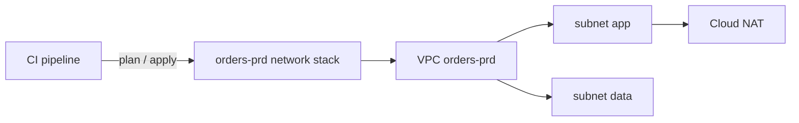

# Optional architecture write-up

Some teams like a short page that explains a stack to the next person who has to change it. Offer one after the code has been accepted, never before, and write it only if the user says yes. It is a companion to the code, not a substitute for reading it.

## Ground rules

- Describe what the HCL actually builds. If something is not in the code, it is not in the write-up; names, regions and address ranges are copied from the code, not retyped from memory.
- Use the format the team already uses. Markdown in the repository is the default (for example next to the stack, or under `docs/architecture/`); if the team keeps architecture notes in a docs tool or wiki, draft the text for that tool instead and let the user paste or publish it.
- Short beats complete. Leave out any section that would only repeat the code.

## Before writing

Ask, in the user's language, only what changes the result:

1. Who will read it: the people who operate the stack, a reviewer, an auditor?
2. Where should it live, and in what format?
3. Which choices deserve a recorded reason (for example, why the cluster nodes are private, or why state is split per environment)?

## Suggested outline

Loosely based on arc42, with C4-style levels for the picture. Rename or drop sections to fit the team's habits.

- **Purpose and constraints.** What the stack is for, who depends on it, and the fixed limits it lives within (region, compliance, budget, org policies).
- **Context.** The stack among its neighbours: other stacks it reads from or feeds, the people and services that use it, external networks. One context-level diagram is usually enough.
- **What it contains.** A prose walk-through of the main pieces and how they connect, pointing at the module calls rather than listing every resource. Mention the settings a reader would otherwise have to dig for (encryption, deletion protection, private access, retention).
- **How it is delivered.** Where state lives, how modules and providers are pinned, and who runs plan and apply from where (a pipeline, HCP Terraform, a person).
- **Decisions.** A few lines each: the situation, what was chosen, what it costs. Link to existing ADRs if the team keeps them.
- **Open points.** Inputs still left as variables, quotas or limits to confirm, follow-up stacks.

## Diagram

If a picture helps, use a Mermaid block inside the Markdown so it renders on the common Git hosts and stays diffable:

````markdown

````

Draw only resources that exist in the code. If the team's docs tool has its own diagram format, use that instead.

## Before handing over

Re-read the write-up against `main.tf`, `variables.tf` and the tfvars. When they disagree, fix the write-up, not the code, unless the user says otherwise. Tell the user where the file is.
